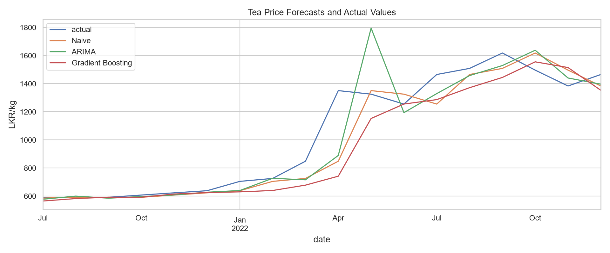

# Sri Lankan Tea Price Forecasting Showdown

**A comparative time-series forecasting project using Naive forecasting, ARIMA, and Gradient Boosting**

  

## Overview

This Data Science project evaluates three approaches for **one-month-ahead forecasting** of Sri Lankan monthly tea auction prices:

1. **Naive baseline:** predicts that the next month's price will equal the most recently observed price.
2. **ARIMA(1,1,1):** a statistical model fitted to the historical price series.
3. **Gradient Boosting Regressor:** a machine-learning model using lagged prices, rolling averages, and calendar features.

The goal is to determine whether more complex models improve upon a simple benchmark, using a consistent time-aware evaluation procedure. Prices are measured in **Sri Lankan rupees per kilogram (LKR/kg)**.

## Research question

> Which of Naive forecasting, ARIMA(1,1,1), and Gradient Boosting produces the lowest one-month-ahead forecasting error for monthly Sri Lankan tea auction prices during the held-out evaluation period?

## Dataset

| Property | Value |
| --- | --- |
| Subject | Monthly Sri Lankan tea auction prices (all elevations) |
| Period | January 2016 – December 2022 |
| Frequency | Monthly |
| Observations | 84 |
| Target variable | `price_lkr_per_kg` |
| Unit | LKR/kg |
| File | `data/tea_prices_2016_2022.csv` |
| Historical source | [Tea Exporters Association of Sri Lanka — Tea Prices](https://teasrilanka.org/tea-prices) |

The notebook validates date continuity, missing values, duplicate months, positive prices, and selected reference observations. The underlying historical table is the primary source; users should cross-check the CSV against the published source when reusing the data.

## Repository structure

```text
Sri-Lankan-Tea-Price-Forecasting/
├── data/
│   └── tea_prices_2016_2022.csv
├── notebooks/
│   ├── forecasting_showdown.ipynb
│   └── results/                         # Results when notebook runs in notebooks/
│       ├── forecast_chart.png
│       ├── forecast_comparison.csv
│       ├── model_performance.csv
│       └── top_10_errors_per_model.csv
├── README.md
├── requirements.txt
└── .gitignore
```

> **Output location:** The notebook saves to `Path('results')`, which is relative to the **current working directory**, not automatically to the notebook's location. If launched with the working directory set to `notebooks/`, files appear under `notebooks/results/`. If run from the repository root, they appear under `results/`. Keep one canonical results folder and update the paths below accordingly.

## Methodology

### 1. Data preparation and exploration

- Load and verify the monthly auction-price dataset.
- Parse dates and create a chronologically indexed series.
- Check missing months, duplicates, and invalid prices.
- Visualize changes in monthly prices and inspect nonstationarity.

### 2. Evaluation setup

| Subset | Dates | Months |
| --- | --- | ---: |
| Initial training history | January 2016 – June 2021 | 66 |
| Held-out evaluation | July 2021 – December 2022 | 18 |

The notebook uses **rolling-origin, one-step-ahead forecasts**. At each test month, the models forecast using data available before that month. As actual monthly observations become available, the forecasting history is updated for the next prediction. This avoids randomly shuffling a time series and provides a consistent comparison.

### 3. Forecasting methods

| Model | Approach |
| --- | --- |
| Naive | Predict the previous month's actual price |
| ARIMA(1,1,1) | Refit ARIMA to available history and forecast one month |
| Gradient Boosting | Refit a tree ensemble using lags (1, 2, 3, 6, 12 months), 3- and 6-month rolling means, and cyclic month features |

### 4. Evaluation metrics

- **MAPE (%):** primary comparison metric; lower is better.
- **MAE (LKR/kg):** mean size of the absolute forecasting error.
- **RMSE (LKR/kg):** error measure that penalizes large errors more heavily.

## Results

The following values are taken from the project's generated `model_performance.csv` (18 evaluation months):

| Model | MAPE (%) ↓ | MAE (LKR/kg) ↓ | RMSE (LKR/kg) ↓ |
| --- | ---: | ---: | ---: |
| **Naive baseline** | **6.99** | **85.56** | **143.52** |
| ARIMA(1,1,1) | 8.14 | 99.91 | 169.43 |
| Gradient Boosting | 9.22 | 109.91 | 176.05 |

**Best model on this test period: Naive baseline.** More complex forecasting techniques did not outperform the baseline under this evaluation setup.

### Actual vs predicted prices



*Figure: one-month-ahead predictions against actual monthly tea auction prices from July 2021 to December 2022. If you store the output in the root `results/` directory instead, change the image path to `results/forecast_chart.png`.*

### Error analysis

The project examines the **10 largest absolute errors per model** (30 entries total). The sharp price movement around April 2022 was especially difficult to predict:

| Model | Example difficult month | Actual (LKR/kg) | Forecast (LKR/kg) | Absolute error (LKR/kg) |
| --- | --- | ---: | ---: | ---: |
| Naive | April 2022 | 1,350.25 | 848.08 | 502.17 |
| ARIMA | May 2022 | 1,324.95 | 1,794.77 | 469.82 |
| Gradient Boosting | April 2022 | 1,350.25 | 741.56 | 608.69 |

The Naive and Gradient Boosting models substantially underpredicted the April 2022 increase. ARIMA subsequently overpredicted May 2022. This illustrates the difficulty of forecasting sudden changes from historical prices alone; the experiment does not establish the economic cause of these movements.

## Reproducing the project

### Requirements

- Python 3.10 or newer
- Jupyter Notebook or Google Colab
- `pandas`, `numpy`, `matplotlib`, `seaborn`, `scikit-learn`, and `statsmodels`

### Local execution

1. Clone the repository and enter it:

   ```bash
   git clone https://github.com/YOUR-USERNAME/Sri-Lankan-Tea-Price-Forecasting.git
   cd Sri-Lankan-Tea-Price-Forecasting
   ```

2. Install dependencies:

   ```bash
   python -m pip install -r requirements.txt
   ```

   If `requirements.txt` is not available yet, install the packages listed above.

3. Start Jupyter from the repository root:

   ```bash
   jupyter notebook notebooks/forecasting_showdown.ipynb
   ```

4. Run all notebook cells, ensuring `data/tea_prices_2016_2022.csv` is accessible. The notebook also supports uploading the CSV in Google Colab if needed.

5. Check the generated files under `results/` or `notebooks/results/`, depending on the working directory.

### Google Colab

Upload or open `notebooks/forecasting_showdown.ipynb` in [Google Colab](https://colab.research.google.com/), run the cells in order, and provide `tea_prices_2016_2022.csv` if prompted. Download the generated outputs and commit them to the chosen repository results directory.

## Output files

| File | Description |
| --- | --- |
| `forecast_chart.png` | Chart of actual and predicted monthly prices |
| `forecast_comparison.csv` | Date, actual price, and three model forecasts |
| `model_performance.csv` | MAPE, MAE, and RMSE by model |
| `top_10_errors_per_model.csv` | Largest absolute errors with signed and percentage errors |

## Conclusions and limitations

The **Naive baseline achieved the lowest MAPE (6.99%)** for the July 2021–December 2022 evaluation window. This result reinforces the value of testing a simple baseline before adopting a more complex model.

Important limitations include a relatively small monthly dataset, the fixed ARIMA configuration, model sensitivity to abrupt price movements, and the lack of external explanatory variables such as exchange rates or production volumes. These findings apply to the evaluated one-step-ahead task and should not be treated as proof that the Naive model will always perform best.

Potential extensions include time-series cross-validation for hyperparameter selection, testing additional historical periods, and introducing external predictors when they are available and known at forecast time.

## References

- [Tea Exporters Association of Sri Lanka — Historical Tea Prices](https://teasrilanka.org/tea-prices)
- [Statsmodels — ARIMA](https://www.statsmodels.org/stable/generated/statsmodels.tsa.arima.model.ARIMA.html)
- [Scikit-learn — GradientBoostingRegressor](https://scikit-learn.org/stable/modules/generated/sklearn.ensemble.GradientBoostingRegressor.html)

---

**Project category:** Data Science · Time Series Forecasting · Machine Learning  
**Assignment:** Forecasting Showdown